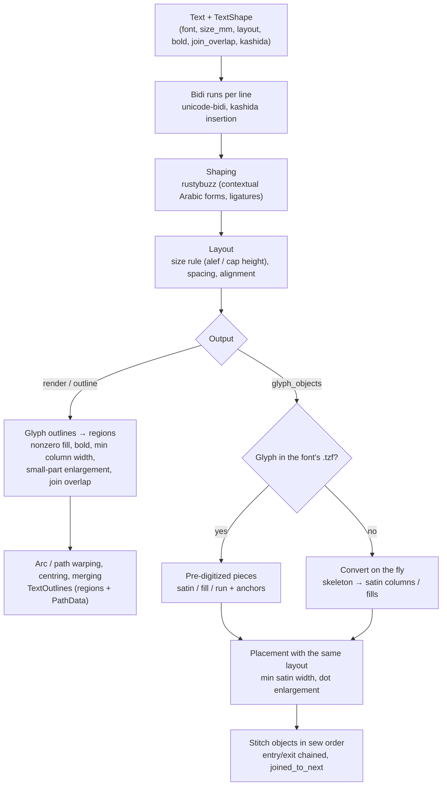
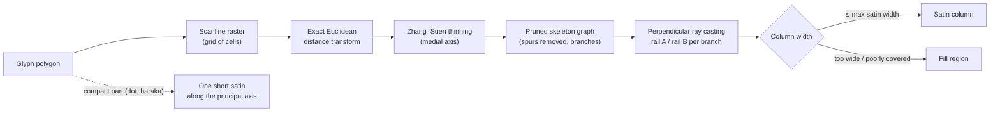
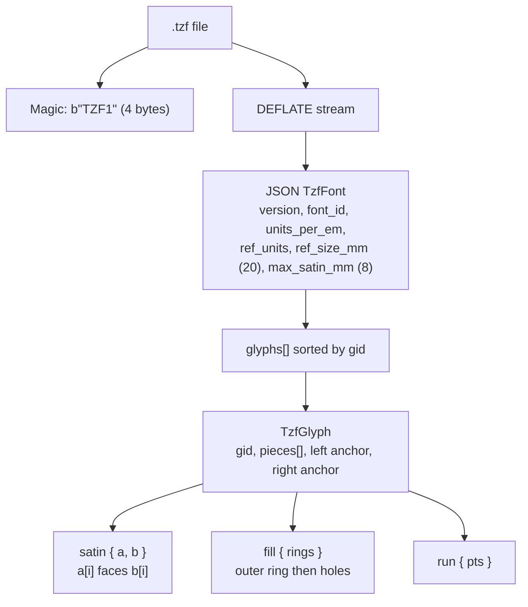
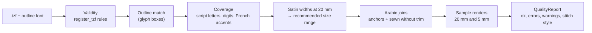

<div dir="rtl">

# tarz-text

[English](README.md) | **العربية**

[](https://github.com/TerminalDZ/tarz-text/actions/workflows/ci.yml)
[](LICENSE)

`tarz-text` **محرّك لكتابة النصوص المطرّزة** (embroidery lettering engine) مكتوب بلغة Rust. يحوّل سطراً من النص العربي أو اللاتيني أو التيفيناغ إلى **أشكال قابلة للخياطة**: أعمدة ساتان (satin columns: مساران متقابلان مع خطوط ربط rungs)، ومناطق تعبئة (fill)، ومسارات غرزة جارية (run)، بوحدة المليمتر وبترتيب الخياطة، إضافةً إلى محيطات مغلقة مدمجة (outlines). يأتي مع 25 خطاً مفتوح المصدر مضمَّناً، ومع **صيغة خطوط التطريز `.tzf`** التي تخزّن كل حرف مقسَّماً مسبقاً إلى قطع ساتان وتعبئة مع نقاط اتصال (connection anchors)، بحيث يمكن خياطة الحروف العربية المتصلة في مسار واحد دون قطع الخيط.

هو محرّك النصوص في [Tarz Studio](https://nexlog.tech)، ويُنشر هنا كحزمة (crate) مستقلة بترخيص MIT.

## لماذا هو جديد

خطوط الحاسوب (TTF/OTF) لا تصف إلا المحيط الخارجي للحرف. أما التطريز فيحتاج إلى أكثر من ذلك، والعربية تكشف كل نقص:

- **غياب اتجاه الغرزة.** المحيط لا يحدّد كيف تعبر الإبرة الخطّ. يستعيد `tarz-text` مسار القلم في كل جزء من الحرف (الهيكل العظمي / المحور الأوسط medial axis) ويبني عمود ساتان تتبع خطوطُ ربطه اتجاهَ الخط.
- **انفصال الحروف المتصلة.** في الخط الرقمي تتلامس الحروف العربية المتصلة على خط عرضه صفر؛ وعلى القماش يفتح شدّ الخيط فجوة هناك. يضيف `tarz-text` **تراكباً عند الاتصال** (join overlap) قابلاً للضبط (القيمة الافتراضية `0.3 mm`) لتبقى الحروف المتصلة منطقة واحدة متصلة دائماً.
- **النقاط والحركات أصغر من أن تُخاط.** تُكبَّر الأجزاء الصغيرة حول مركز ثقلها حتى مساحة دنيا بدلاً من حذفها.
- **مقياس الحجم اللاتيني لا يصلح للعربية.** ارتفاع الحرف الكبير (cap height) يجعل النص العربي صغيراً وغير متناسق. يقيس `tarz-text` العربية بارتفاع **الألف المعزولة `ا`**، وهو المقياس التقليدي لجسم الحرف.
- **رقمنة الخط مرة واحدة لا عند كل عرض.** تخزّن صيغة `.tzf` قطع الساتان والتعبئة المرقمنة مسبقاً مع نقطتَي اتصال يسرى ويمنى، بترميز الفروق (delta encoding) وضغط DEFLATE.

أسس تشكيل النص مكتبات مفتوحة المصدر قياسية (`rustybuzz` لتشكيل OpenType، و`unicode-bidi` لخوارزمية الاتجاه الثنائي، و`ttf-parser` لمحيطات الحروف). أما طبقة التطريز فوقها — تفكيك الخطوط إلى أعمدة ساتان، وقواعد التطريز، وصيغة `.tzf` — فهي عمل أصيل من «طرز».

## الميزات

- تشكيل الحروف العربية (rustybuzz)، وخوارزمية Unicode bidi (فقرة لكل سطر)، وأسطر مختلطة عربية/لاتينية، والأرقام العربية والفارسية، وإدراج الكشيدة (tatweel).
- التخطيطات (layouts): سطر مستقيم (يسار / وسط / يمين)، وقوس دائري (خارج الدائرة أو داخلها)، ونص على مسار اختياري.
- قاعدة الحجم: النص العربي بارتفاع الألف المعزولة، وغيره بارتفاع الحرف الكبير (OS/2 `sCapHeight` أو ارتفاع `H`)؛ ويحصل الخط البديل (fallback) على مقياسه الخاص لتتناسق الأسطر المختلطة.
- قواعد التطريز (كلها بالمليمتر): إزاحة التسميك (bold)، والحد الأدنى لعرض العمود (`MIN_COLUMN_MM = 1.0`، مع تسميك لا يتجاوز `MAX_THICKEN_MM = 0.3` لكل جانب)، وتكبير الأجزاء الصغيرة (`MIN_PART_AREA_MM2 = π·0.6² ≈ 1.13 mm²`)، والتراكب عند الاتصال العربي (`DEFAULT_JOIN_OVERLAP_MM = 0.3`)، وحدود عرض الساتان (`MIN_SATIN_MM = 1.0` و`MAX_SATIN_MM = 8.0`؛ وما هو أعرض يصبح تعبئة)، وتحذير للنص الأصغر من `SMALL_TEXT_MM = 6.0`.
- مُخرَجان: محيطات مدمجة / مناطق لكل عنقود حروف (`render` و`outline` و`outline_regions`)، وكائنات غرز مرقمنة مسبقاً بترتيب الخياطة مع نقاط دخول/خروج وعلامة `joined_to_next` (`glyph_objects` و`glyph_objects_report`).
- تفكيك الخطوط (`skeleton`): تحويل نقطي (scanline raster) ← تحويل المسافة الإقليدية الدقيق ← ترقيق Zhang–Suen ← رسم بياني مشذَّب للهيكل ← عمود ساتان لكل فرع، تُحدَّد مساراته بإسقاط أشعة متعامدة.
- صيغة `.tzf`: ترميز وفك ترميز، ومحوِّل من TTF/OTF (`tzf::convert_font`)، والحروف الناقصة في ملف `.tzf` تُحوَّل فورياً بالخوارزمية نفسها.
- تسجيل الخطوط أثناء التشغيل مع تحقق صارم للملفات غير الموثوقة (حدود للحجم، وفك ضغط محدود، وفحوص بنيوية، وتطابق المحيط مع `.tzf`).
- فحوص جودة الخطوط (`quality::check_font`) ومعاينات SVG (`quality::preview_svg`).
- 25 خطاً مضمَّناً (10 عربية + لاتينية، و14 لاتينية، وخط تيفيناغ واحد)، كلها بترخيص SIL OFL 1.1، ومضمَّنة عبر `include_bytes!`: لا حاجة إلى نظام ملفات، وتُبنى لـ `wasm32-unknown-unknown`.
- `#![forbid(unsafe_code)]`.

## البدء السريع

`tarz-text` غير منشور على crates.io بعد؛ استخدم وسم git:

```toml
[dependencies]
tarz-text = { git = "https://github.com/TerminalDZ/tarz-text", tag = "v1.0.0" }
```

يتطلب Rust 1.88 أو أحدث (edition 2024).

</div>

```rust
use tarz_text::design::TextShape;
use tarz_text::{FontRegistry, TextStitchShape};

fn main() -> tarz_text::Result<()> {
    let fonts = FontRegistry::bundled();
    let shape = TextShape {
        text: "طرز Tarz".into(),
        font: "amiri".into(),
        size_mm: 20.0, // Arabic: height of the isolated alef
        ..Default::default()
    };

    // Closed outlines in mm (y down), centred on the origin.
    let outline = tarz_text::outline(&shape, &fonts)?;
    println!("outline: {} sub-paths", outline.subpaths.len());
    let _svg_path_data = outline.to_svg();

    // Pre-digitized stitch shapes in sew order.
    let result = tarz_text::glyph_objects_report(&shape, &fonts)?;
    for obj in &result.objects {
        match &obj.shape {
            TextStitchShape::Satin { rungs, .. } => println!("satin, {} rungs", rungs.len()),
            TextStitchShape::Fill { region } => println!("fill, {:.1} mm²", region.area()),
            TextStitchShape::Run { .. } => println!("run"),
        }
    }
    for w in &result.report.warnings {
        println!("warning: {w}");
    }
    Ok(())
}
```

<div dir="rtl">

### الأمثلة

</div>

```text
cargo run --example lettering_svg -- "طرز Tarz 2026" amiri lettering.svg
cargo run --example load_tzf -- assets/fonts/amiri.tzf assets/fonts/Amiri-Regular.ttf "بسم الله"
cargo run --release --example build_tzf -- assets/fonts/Oswald-Medium.ttf oswald.tzf
```

<div dir="rtl">

- `lettering_svg` — نص عربي ولاتيني مختلط ← المحيط ومسارات الساتان وخطوط الربط والتعبئات والمسارات الجارية مرسومة في ملف SVG، مع تقرير الكتابة.
- `load_tzf` — يفك ترميز ملف `.tzf`، ويطبع إحصاءاته، ويشغّل فحوص الجودة، ويسجّله أثناء التشغيل ويكتب به نصاً.
- `build_tzf` — يحوّل خط TTF/OTF إلى `.tzf` (الخيار `--arabic` لقاعدة حجم الألف).

### النشر على crates.io (للمشرفين)

الحزمة جاهزة لـ crates.io (الأمر `cargo package` ينجح). باستخدام رمز API الخاص بمالك الحساب على crates.io:

</div>

```text
cargo login <CRATES_IO_TOKEN>
cargo publish
```

<div dir="rtl">

## نظرة عامة على الواجهة البرمجية (API)

| العنصر | الغرض |
|------|---------|
| `FontRegistry::bundled()` / `empty()` | مجموعة الخطوط (الخطوط المضمَّنة، أو البدء فارغاً). تُحلَّل الخطوط وبيانات `.tzf` عند أول استخدام. |
| `FontRegistry::register`, `register_with_tzf` | إضافة خط TTF/OTF (`&'static [u8]`)، اختيارياً مع ملف `.tzf` الخاص به. |
| `FontRegistry::register_tzf(tzf, outline, &RuntimeFontMeta)` | التحقق من ملف `.tzf` غير موثوق مع خط المحيط وتسجيلهما أثناء التشغيل (المعرّف `store:<key>`)؛ و`unregister` و`runtime_fonts`. |
| `FontRegistry::resolve`, `would_fall_back`, `list`, `info` | البحث عن الخطوط والرجوع إلى خط بديل بحسب نظام الكتابة. |
| `design::TextShape` | النص، ومعرّف الخط، و`size_mm`، وتباعد الحروف والأسطر، و`TextAlign`، و`TextLayout` (`Straight` و`Arc` و`Path`)، و`bold`، و`join_overlap`، و`kashida`. قابل للتسلسل عبر serde. |
| `render(&shape, &fonts)` ← `TextOutlines` | المناطق بترتيب الخياطة، و`PathData` مدمج، والخط المستخدم، وعلامة الرجوع، والتسميك، والأجزاء المكبَّرة، والتحذيرات، وأصل التخطيط. |
| `outline`, `outline_regions`, `arc_center` | اختصارات فوق `render`. |
| `glyph_objects`, `glyph_objects_report` ← `TextStitchResult` | كائنات `TextStitchObject` (`Satin { rail_a, rail_b, rungs }` و`Fill { region }` و`Run { path }`، ودخول/خروج، و`joined_to_next`، والسطر/الكلمة/الحركة/الاتجاه) مع تقرير `TextReport`. |
| `tzf::{TzfFont, TzfGlyph, TzfPiece}` | نموذج `.tzf`؛ و`encode` و`decode` و`decode_limited`. |
| `tzf::convert_font`, `convert_glyph`, `corpus_glyphs` | المحوِّل من TTF/OTF إلى `.tzf`. |
| `quality::check_font`, `quality::preview_svg` | تقرير جودة لزوج `.tzf` + خط المحيط؛ ومعاينة SVG. |
| `has_arabic`, `insert_kashida`, `paragraph_rtl`, `visual_runs` | أدوات مساعدة للاتجاه الثنائي والعربية. |
| `geom` | `Point` و`Affine` و`Rect` و`PathData`/`SubPath`/`PathCmd` (تحليل SVG وتسلسله، والتسطيح)، و`Polygon`/`MultiPolygon` (العمليات المنطقية والإزاحة عبر `geo`)، وأدوات للخطوط المتعددة. |
| `Error`, `Result` | نوع الخطأ (`Format` و`Font` و`Invalid` …). |

كل الإحداثيات بالمليمتر، ومحور y متجه إلى الأسفل. التوثيق المولَّد: `cargo doc --open`.

## كيف يعمل

### مسار المعالجة

</div>



<div dir="rtl">

### من منطقة الحرف إلى أعمدة الساتان (الهيكل العظمي)

</div>



<div dir="rtl">

### صيغة `.tzf` (الإصدار 1)

</div>



<div dir="rtl">

الإحداثيات بوحدات الخط الصحيحة (font units)، ومحور x نحو اليمين، و**محور y نحو الأسفل**، والأصل عند أصل الحرف على خط الأساس. قوائم النقاط مصفوفات مسطّحة مرمَّزة بالفروق `[x0, y0, dx1, dy1, …]`. تُحدَّد القطع عند ارتفاع حرف مرجعي قدره 20 مم: الخطوط التي لا يتجاوز عرضها 8 مم تصبح أعمدة ساتان، والمساحات الأعرض تعبئة، والنقاط والحركات المدمجة ساتاناً قصيراً. `left` هي نقطة خروج الحرف العربي (حيث يكمل الحرف التالي المتصل به)، و`right` نقطة دخوله.

### فحوص الجودة

</div>



<div dir="rtl">

## دليل الدمج في مشاريع أخرى

**برامج التطريز.** استخدم `glyph_objects_report` وحوّل كل `TextStitchObject` بمولّد الغرز الخاص بك: أعمدة ساتان بين `rail_a` و`rail_b` (تثبّت `rungs` اتجاه الغرزة)، وتعبئة تاتامي لـ `Fill`، وغرزة جارية لـ `Run`. خِط الكائنات بالترتيب المعطى؛ وعندما تكون `joined_to_next` صحيحة، انتقل من `exit` إلى `entry` التالي داخل جسم الحرف بدلاً من قطع الخيط. اعرض `report.warnings` للمستخدم (الرمز قبل النقطتين: `text_too_small` و`font_fallback` و`below_font_min_size`). لا ينتج `tarz-text` نقاط الإبرة ولا ملفات الماكينات (DST وPES …)؛ فتلك مهمة التطبيق المضيف.

**آلات CNC والراسمات (plotters) والليزر وقواطع الفينيل.** استخدم `outline` (مسارات فرعية مغلقة غير متداخلة بالمليمتر، ومحور y نحو الأسفل) واكتبه كبيانات مسار SVG عبر `PathData::to_svg()` أو سطّحه عبر `PathData::flatten(tolerance)`. ويعطي `outline_regions` الهندسة نفسها لكل عنقود حروف (على شكل `MultiPolygon` وبترتيب الخياطة) عندما يجب أن يتبع مسار الأداة ترتيب القراءة.

**Rust وWebAssembly.** الخطوط مُترجَمة داخل الملف التنفيذي، فلا تحتاج الحزمة إلى نظام ملفات وتُبنى لـ `wasm32-unknown-unknown` (الأمر `cargo check --target wasm32-unknown-unknown` جزء من CI). كل أنواع البيانات العامة تطبّق `serde::Serialize`/`Deserialize`، مما يسهّل تمرير `TextShape` والنتائج عبر حدود JSON (`wasm-bindgen` أو Tauri أو خدمة ويب). حمّل خطوطاً إضافية أثناء التشغيل عبر `FontRegistry::register_tzf`.

## ملاحظات الأداء

قيست مرة واحدة على جهاز المؤلف بنظام Windows (rustc 1.99.1)، وليست مجموعة قياس أداء:

- حوّل `build_tzf` (بنمط release) الخط `Oswald-Medium.ttf` (151 حرفاً من المدوّنة) في 2.8 ثانية؛ والناتج مطابق بايتاً ببايت للملف المضمَّن `oswald.tzf`.
- حجم الملف المضمَّن `amiri.tzf` هو 138,003 بايت على القرص مقابل 957,056 بايت من JSON بعد فك الضغط (أصغر بنسبة 85.6 %)، ويضم 1,008 حروف.

## القيود

- المُخرَج هندسة (محيطات، ومسارات ساتان وخطوط ربط، ومناطق تعبئة، ومسارات جارية) وليس غرزاً: البطانة (underlay) والكثافة وتعويض السحب وصيغ الماكينات خارج النطاق.
- الخطوط المسجَّلة عبر `register` يجب أن تكون `&'static [u8]`؛ والخطوط المسجَّلة أثناء التشغيل عبر `register_tzf` تبقى طوال عمر العملية (بحدّ أقصى `MAX_RUNTIME_FONTS`).
- أنظمة الكتابة ذات المعالجة الخاصة: العربية (الاتصال، وقاعدة الحجم، والتراكب عند الاتصال) وفحوص تغطية التيفيناغ؛ أما الأنظمة الأخرى فيشكّلها rustybuzz لكنها لا تحصل إلا على القواعد العامة.
- النص العمودي غير مدعوم؛ التخطيطات هي المستقيم والقوس والمسار.
- جدول الخطوط المضمَّنة (`src/fonts.rs` و`assets/fonts/`) ولّدته أداة خطوط Tarz Studio، وهي ليست جزءاً من هذا المستودع.

## مستخدم في Tarz Studio

يشغّل `tarz-text` كتابة النصوص العربية واللاتينية في محرّر التطريز ضمن **Tarz Studio** — <https://nexlog.tech>.

## المساهمة

المساهمات مرحَّب بها — راجع [CONTRIBUTING.md](CONTRIBUTING.md) و[مدونة السلوك](CODE_OF_CONDUCT.md). أبلغ عن الثغرات الأمنية كما هو موضّح في [SECURITY.md](SECURITY.md). التغييرات مدرجة في [CHANGELOG.md](CHANGELOG.md).

## الترخيص

الشيفرة المصدرية مرخّصة بموجب [رخصة MIT](LICENSE) (Copyright (c) 2026 Tarz).

**الخطوط المضمَّنة ليست بترخيص MIT.** كل خط في `assets/fonts/` (ملفات `.ttf` وملفات `.tzf` المشتقة منها) يحتفظ بترخيصه الخاص، وهو SIL Open Font License 1.1. نص الترخيص الكامل وإشعار حقوق النشر لكل خط موجودان في [`assets/fonts/licenses/`](assets/fonts/licenses/)؛ والمصادر والإصدارات في [`assets/fonts/LICENSES.md`](assets/fonts/LICENSES.md) و[`assets/fonts/fonts.json`](assets/fonts/fonts.json). بموجب OFL يجوز تضمين الخطوط وإعادة توزيعها مع البرمجيات، لكن لا يجوز بيعها منفردة.

</div>
