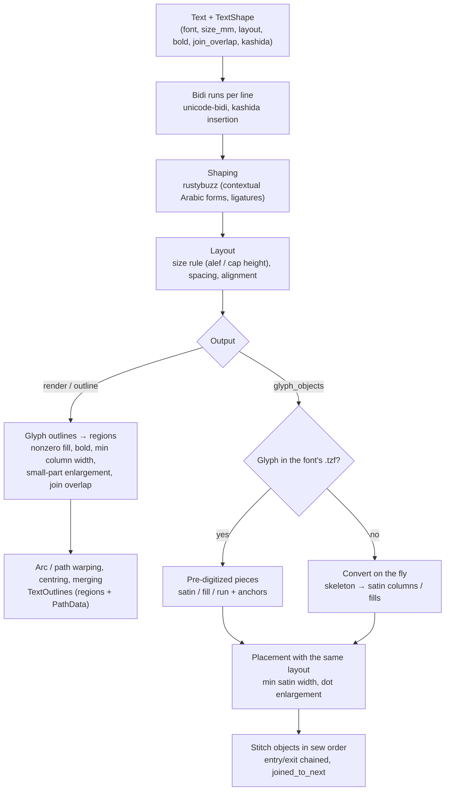
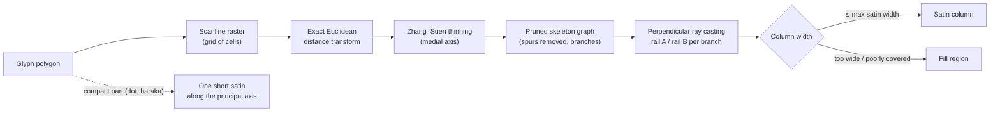
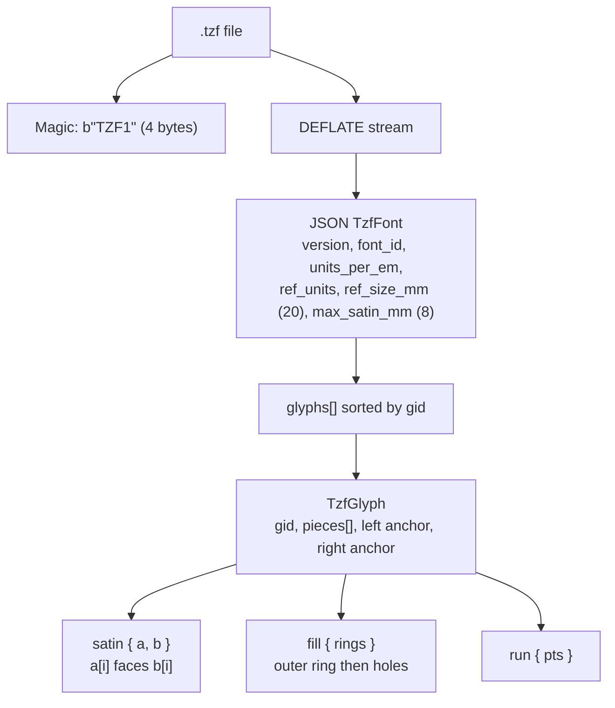
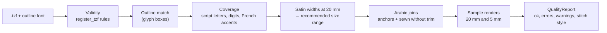

# tarz-text

**English** | [العربية](README.ar.md)

[](https://github.com/TerminalDZ/tarz-text/actions/workflows/ci.yml)
[](LICENSE)

`tarz-text` is an **embroidery lettering engine** written in Rust. It turns a
line of Arabic, Latin or Tifinagh text into **sewable shapes**: satin columns
(two facing rails with rungs), fill regions and running paths, in
millimetres and in sew order, together with merged closed outlines. It ships
25 bundled open-source fonts and the **`.tzf` embroidery font format**, which
stores every glyph already split into satin/fill pieces with connection
anchors so joined Arabic letters can be sewn as one path without trims.

It is the text engine of [Tarz Studio](https://nexlog.tech), released as a
standalone MIT-licensed crate.

## Why it is new

Desktop fonts (TTF/OTF) only describe the outline of a letter. Embroidery
needs more, and Arabic exposes every gap:

- **No stitch direction.** An outline does not say how a needle should cross
  the stroke. `tarz-text` recovers the pen path of each stroke (skeleton /
  medial axis) and builds a satin column whose rungs follow the stroke.
- **Joins pull apart.** In a font, joined Arabic letters touch along a line
  of zero width; on fabric the thread pull opens a gap there. `tarz-text`
  adds a configurable **join overlap** (default `0.3 mm`) so joined letters
  always form one connected region.
- **Dots and harakat are too small to sew.** Tiny parts are enlarged around
  their centroid up to a minimum area instead of being dropped.
- **The Latin size measure fails for Arabic.** Capital height makes Arabic
  text small and inconsistent. `tarz-text` sizes Arabic by the height of the
  **isolated alef `ا`**, the traditional measure of the letter body.
- **Fonts are digitized once, not at every render.** The `.tzf` format stores
  pre-digitized satin/fill pieces plus left/right connection anchors, delta
  encoded and DEFLATE compressed.

The text-shaping foundations are standard open-source crates (`rustybuzz`
for OpenType shaping, `unicode-bidi` for the bidirectional algorithm,
`ttf-parser` for glyph outlines). The embroidery layer on top of them —
stroke decomposition into satin columns, the embroidery rules and the
`.tzf` format — is original Tarz work.

## Features

- Arabic shaping (rustybuzz), Unicode bidi (one paragraph per line), mixed
  Arabic/Latin lines, Arabic and Persian digits, kashida (tatweel) insertion.
- Layouts: straight (left / centre / right), circular arc (outside or
  inside), text on an arbitrary path.
- Size rule: Arabic text by the isolated alef, other text by the capital
  height (OS/2 `sCapHeight` or the height of `H`); fallback fonts get their
  own scale so mixed lines line up.
- Embroidery rules (all in mm): bold offset, minimum column width
  (`MIN_COLUMN_MM = 1.0`, thickening capped at `MAX_THICKEN_MM = 0.3` per
  side), small-part enlargement (`MIN_PART_AREA_MM2 = π·0.6² ≈ 1.13 mm²`),
  Arabic join overlap (`DEFAULT_JOIN_OVERLAP_MM = 0.3`), satin width limits
  (`MIN_SATIN_MM = 1.0`, `MAX_SATIN_MM = 8.0`; wider strokes become fills),
  small-text warning below `SMALL_TEXT_MM = 6.0`.
- Two outputs: merged outlines / per-cluster regions (`render`, `outline`,
  `outline_regions`) and pre-digitized stitch objects in sew order with
  entry/exit points and a `joined_to_next` flag (`glyph_objects`,
  `glyph_objects_report`).
- Stroke decomposition (`skeleton`): scanline raster → exact Euclidean
  distance transform → Zhang–Suen thinning → pruned skeleton graph → one
  satin column per branch with rails found by perpendicular ray casting.
- `.tzf` font format: encode / decode, a converter from TTF/OTF
  (`tzf::convert_font`), and glyphs missing from a `.tzf` converted on the
  fly with the same algorithm.
- Runtime font registration with hardened validation for untrusted files
  (size caps, bounded inflate, structural checks, outline/`.tzf` match).
- Font quality checks (`quality::check_font`) and SVG previews
  (`quality::preview_svg`).
- 25 bundled fonts (10 Arabic + Latin, 14 Latin, 1 Tifinagh), all SIL OFL
  1.1, embedded with `include_bytes!`: no file system needed, builds for
  `wasm32-unknown-unknown`.
- `#![forbid(unsafe_code)]`.

## Quick start

`tarz-text` is not on crates.io yet; depend on the git tag:

```toml
[dependencies]
tarz-text = { git = "https://github.com/TerminalDZ/tarz-text", tag = "v1.0.0" }
```

Requires Rust 1.88 or newer (edition 2024).

```rust
use tarz_text::design::TextShape;
use tarz_text::{FontRegistry, TextStitchShape};

fn main() -> tarz_text::Result<()> {
    let fonts = FontRegistry::bundled();
    let shape = TextShape {
        text: "طرز Tarz".into(),
        font: "amiri".into(),
        size_mm: 20.0, // Arabic: height of the isolated alef
        ..Default::default()
    };

    // Closed outlines in mm (y down), centred on the origin.
    let outline = tarz_text::outline(&shape, &fonts)?;
    println!("outline: {} sub-paths", outline.subpaths.len());
    let _svg_path_data = outline.to_svg();

    // Pre-digitized stitch shapes in sew order.
    let result = tarz_text::glyph_objects_report(&shape, &fonts)?;
    for obj in &result.objects {
        match &obj.shape {
            TextStitchShape::Satin { rungs, .. } => println!("satin, {} rungs", rungs.len()),
            TextStitchShape::Fill { region } => println!("fill, {:.1} mm²", region.area()),
            TextStitchShape::Run { .. } => println!("run"),
        }
    }
    for w in &result.report.warnings {
        println!("warning: {w}");
    }
    Ok(())
}
```

### Examples

```text
cargo run --example lettering_svg -- "طرز Tarz 2026" amiri lettering.svg
cargo run --example load_tzf -- assets/fonts/amiri.tzf assets/fonts/Amiri-Regular.ttf "بسم الله"
cargo run --release --example build_tzf -- assets/fonts/Oswald-Medium.ttf oswald.tzf
```

- `lettering_svg` — mixed Arabic + Latin text → outline + satin rails/rungs,
  fills and runs drawn into an SVG, plus the lettering report.
- `load_tzf` — decodes a `.tzf`, prints its statistics, runs the quality
  checks, registers it at runtime and sets text with it.
- `build_tzf` — converts a TTF/OTF font into a `.tzf` (`--arabic` for the
  alef size rule).

### Publishing to crates.io (maintainers)

The package is ready for crates.io (`cargo package` passes). With a
crates.io API token of the owner:

```text
cargo login <CRATES_IO_TOKEN>
cargo publish
```

## API overview

| Item | Purpose |
|------|---------|
| `FontRegistry::bundled()` / `empty()` | Font collection (bundled fonts, or start empty). Faces and `.tzf` data are parsed lazily. |
| `FontRegistry::register`, `register_with_tzf` | Add a TTF/OTF (`&'static [u8]`), optionally with its `.tzf`. |
| `FontRegistry::register_tzf(tzf, outline, &RuntimeFontMeta)` | Validate and register an untrusted `.tzf` + outline font at runtime (id `store:<key>`); `unregister`, `runtime_fonts`. |
| `FontRegistry::resolve`, `would_fall_back`, `list`, `info` | Font lookup and script-aware fallback. |
| `design::TextShape` | Text, font id, `size_mm`, letter/line spacing, `TextAlign`, `TextLayout` (`Straight`, `Arc`, `Path`), `bold`, `join_overlap`, `kashida`. Serde-serializable. |
| `render(&shape, &fonts)` → `TextOutlines` | Regions in sew order, merged `PathData`, font used, fallback flag, thickening, enlarged parts, warnings, layout origin. |
| `outline`, `outline_regions`, `arc_center` | Shortcuts over `render`. |
| `glyph_objects`, `glyph_objects_report` → `TextStitchResult` | `TextStitchObject`s (`Satin { rail_a, rail_b, rungs }`, `Fill { region }`, `Run { path }`, entry/exit, `joined_to_next`, line/word/mark/rtl) plus a `TextReport`. |
| `tzf::{TzfFont, TzfGlyph, TzfPiece}` | `.tzf` model; `encode`, `decode`, `decode_limited`. |
| `tzf::convert_font`, `convert_glyph`, `corpus_glyphs` | TTF/OTF → `.tzf` converter. |
| `quality::check_font`, `quality::preview_svg` | Quality report of a `.tzf` + outline pair; SVG preview. |
| `has_arabic`, `insert_kashida`, `paragraph_rtl`, `visual_runs` | Bidi / Arabic helpers. |
| `geom` | `Point`, `Affine`, `Rect`, `PathData`/`SubPath`/`PathCmd` (SVG parse/serialize, flattening), `Polygon`/`MultiPolygon` (booleans and offsets via `geo`), polyline helpers. |
| `Error`, `Result` | Error type (`Format`, `Font`, `Invalid`, …). |

All coordinates are millimetres with the y axis pointing down. Generated docs:
`cargo doc --open`.

## How it works

### Pipeline



### Glyph region → satin columns (skeleton)



### The `.tzf` format (version 1)



Coordinates are integer font units, x right, **y down**, origin at the
glyph origin on the baseline. Point lists are delta-encoded flat arrays
`[x0, y0, dx1, dy1, …]`. Pieces are decided at the reference letter height
of 20 mm: strokes up to 8 mm wide become satin columns, wider areas fills,
compact dots/harakat a short satin. `left` is the exit anchor of an Arabic
letter (where the next, joined letter continues), `right` its entry.

### Quality checks



## Integration guide

**Embroidery software.** Use `glyph_objects_report` and convert each
`TextStitchObject` with your own stitch generator: satin columns between
`rail_a`/`rail_b` (the `rungs` pin the stitch direction), tatami fill for
`Fill`, running stitch for `Run`. Sew objects in the given order; when
`joined_to_next` is true, travel from `exit` to the next `entry` inside the
letter body instead of trimming. Show `report.warnings` to the user
(codes before the colon: `text_too_small`, `font_fallback`,
`below_font_min_size`). `tarz-text` does not produce needle points or
machine files (DST, PES, …); that is the job of the host application.

**CNC, plotters, laser and vinyl cutters.** Use `outline` (closed,
non-overlapping sub-paths in mm, y down) and write it as SVG path data with
`PathData::to_svg()` or flatten it with `PathData::flatten(tolerance)`.
`outline_regions` gives the same geometry per letter cluster (as
`MultiPolygon`s, in sew order) when the tool path should follow the
reading order.

**Rust and WebAssembly.** Fonts are compiled into the binary, so the crate
needs no file system and builds for `wasm32-unknown-unknown`
(`cargo check --target wasm32-unknown-unknown` is part of CI). All public
data types implement `serde::Serialize`/`Deserialize`, which makes it easy
to pass `TextShape` and results across a JSON boundary (`wasm-bindgen`,
Tauri, a web service). Load extra fonts at runtime with
`FontRegistry::register_tzf`.

## Performance notes

Measured once on the author's Windows machine (rustc 1.99.1), not a
benchmark suite:

- `build_tzf` (release) converted `Oswald-Medium.ttf` (151 corpus glyphs)
  in 2.8 s; the output is byte-identical to the bundled `oswald.tzf`.
- The bundled `amiri.tzf` is 138,003 bytes on disk for 957,056 bytes of
  inflated JSON (85.6 % smaller), 1,008 glyphs.

## Limitations

- Output is geometry (outlines, satin rails/rungs, fill regions, runs), not
  stitches: underlay, density, pull compensation and machine formats are
  out of scope.
- Fonts registered with `register` must be `&'static [u8]`; runtime fonts
  registered through `register_tzf` are kept for the life of the process
  (bounded by `MAX_RUNTIME_FONTS`).
- Scripts handled specially: Arabic (joining, size rule, join overlap) and
  Tifinagh coverage checks; other scripts are shaped by rustybuzz but get
  only the generic rules.
- Vertical text is not supported; layouts are straight, arc and path.
- The bundled fonts table (`src/fonts.rs`, `assets/fonts/`) was generated
  by the Tarz Studio font pipeline, which is not part of this repository.

## Used in Tarz Studio

`tarz-text` powers the Arabic and Latin lettering in the embroidery editor
of **Tarz Studio** — <https://nexlog.tech>.

## Contributing

Contributions are welcome — see [CONTRIBUTING.md](CONTRIBUTING.md) and the
[Code of Conduct](CODE_OF_CONDUCT.md). Report security issues as described
in [SECURITY.md](SECURITY.md). Changes are listed in
[CHANGELOG.md](CHANGELOG.md).

## Licence

The source code is licensed under the [MIT licence](LICENSE)
(Copyright (c) 2026 Tarz).

**The bundled fonts are not MIT.** Every font in `assets/fonts/` (the
`.ttf` files and the `.tzf` files derived from them) keeps its own licence,
the SIL Open Font License 1.1. The full licence text and copyright notice
of each font are in [`assets/fonts/licenses/`](assets/fonts/licenses/);
sources and versions are in
[`assets/fonts/LICENSES.md`](assets/fonts/LICENSES.md) and
[`assets/fonts/fonts.json`](assets/fonts/fonts.json). Under the OFL the
fonts may be bundled and redistributed with software but may not be sold
on their own.
